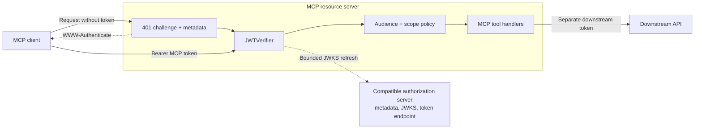
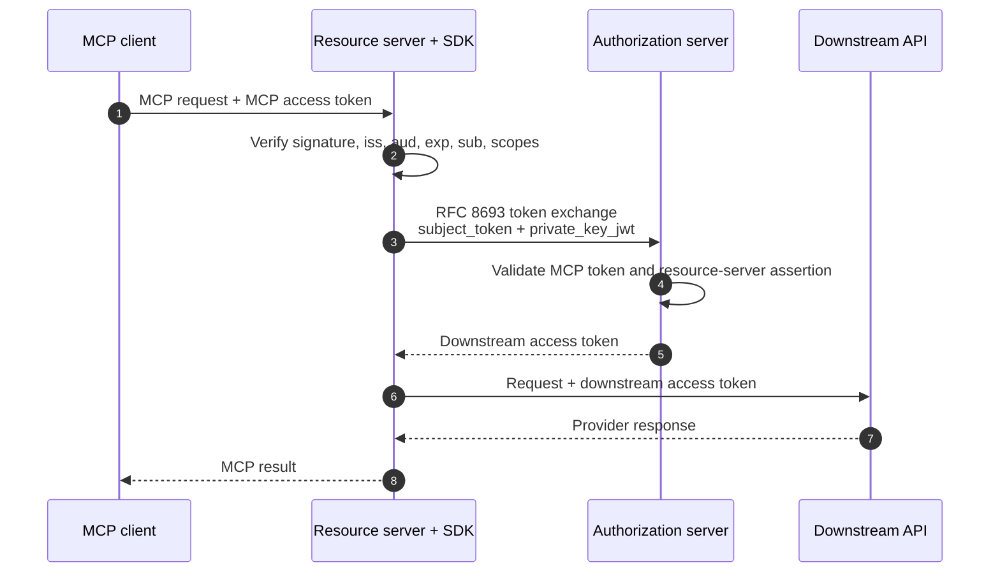

# Auth client SDKs

All three SDKs are installable without the authorization server. They work with the bundled server or a third-party OAuth authorization server that publishes compatible metadata.

The SDK is the authorization boundary inside a resource server. MCP tool handlers
receive a verified subject and scopes; they do not parse bearer tokens, fetch JWKS,
or know which identity provider authenticated the caller.



The Python package is currently Git-installable (a VCS pin is appropriate until
the package is published to an index):

```bash
python -m pip install "mcp-auth-client @ git+https://github.com/Agent-Hellboy/mcp-auth.git#subdirectory=auth-client/python"
```

## Python

```python
from mcp_auth_client import JWTVerifier, RemoteAuthProvider

verifier = JWTVerifier(
    jwks_uri="https://auth.example.com/.well-known/jwks.json",
    issuer="https://auth.example.com",
    audience="https://mcp.example.com",
    required_scopes={"tools:read"},
)
auth = RemoteAuthProvider(
    token_verifier=verifier,
    authorization_servers=["https://auth.example.com"],
    base_url="https://mcp.example.com",
).build()
```

Install the FastMCP extra only when using FastMCP. Otherwise call `JWTVerifier.verify` and return `unauthorized_headers(...)` from the resource server's 401 response.

The verifier is explicitly RS256-only, refreshes JWKS on a bounded schedule, validates `iss`, `aud`, `exp`, `nbf`, `sub`, `typ` (absent, `JWT`, or `at+jwt`), and required scopes, and rejects unknown signing keys. Clock skew defaults to 60 seconds (`clock_skew` in Python, `ClockSkew` in Go, `clockSkewSeconds` in TypeScript). JWKS fetches time out after 10 seconds. `VerifyContext` and `RequireToken` propagate request cancellation and emit standards-compliant bearer challenges.

`build_remote_auth`, `build_exchange_client`, `public_base_url`,
`TokenExchangeError`, and `ExchangedToken` are part of the SDK itself. The
`ssrf_safe` option (TypeScript: `ssrfSafe`) controls the JWKS fetch policy and defaults to on. It checks the URL text, not DNS: it blocks non-HTTPS URLs except loopback names, credential-bearing URLs, and non-loopback IP literals. A hostname that resolves to a private address is not blocked, because `jwks_uri` is operator-configured. Disable it only for a controlled local test transport. The Go client does not apply this URL policy; set `JWKSURL` to an address you trust.

Python requires 3.12 or newer. CPython still supports 3.11; this SDK does not, because 3.12 is the oldest interpreter the repository type-checks and CI did not claim an untested runtime. CI covers 3.12, 3.13, and 3.14.

## Go

Import `github.com/Agent-Hellboy/mcp-auth/auth-client/go/mcpauth`, configure `JWTVerifier`, and use `DiscoverProtectedResource`, `DiscoverAuthorizationServer`, `ParseWWWAuthenticate`, and `TokenExchangeClient`. The Go SDK uses the standard library and supports bounded token caching. Install the client module at the `auth-client/go/v0.3.0` release tag.

`auth-client/go/go.mod` declares `go 1.18`. That is the language floor of the client: the source uses the predeclared `any` alias and otherwise only long-stable standard-library APIs, and it has no third-party dependencies. The authorization server stays on Go 1.26, which is the oldest Go release this repository supports for the server. CI runs the client and server unit tests, including `govulncheck`, on Go 1.26 and 1.27. End-to-end and image builds stay on 1.26.

## TypeScript

The TypeScript SDK supports Node.js 22 or newer and has no runtime dependencies.
The package is ESM-only. CommonJS callers need Node 22 or later so `require(esm)` can load it. CI tests the SDK on Node 22, 24, and 26.
Until it is published to npm, install it from `auth-client/typescript` in a
checkout or reference that directory as a workspace dependency.

```ts
import { JWTVerifier, authenticateRequest } from "@mcp-auth/client";

const verifier = new JWTVerifier({
  jwksUri: "https://auth.example.com/.well-known/jwks.json",
  issuer: "https://auth.example.com",
  audience: "https://mcp.example.com/mcp",
  requiredScopes: ["tools:read"],
});

const claims = await authenticateRequest(request, verifier);
```

The package also exports protected-resource metadata and bearer-challenge
helpers, authorization-server and protected-resource discovery, and an RFC 8693
`TokenExchangeClient` with optional `PrivateKeyJWTClientAuth`.

## Publishing protected resource metadata

Every MCP resource server must publish an RFC 9728 document saying which
authorization servers issue its tokens. The MCP authorization spec requires the
`authorization_servers` field; in practice `scopes_supported` matters just as
much, because it is the only thing that tells a client which scope to request.

Omit it and the failure is quiet and misleading: the client asks for no scope,
the authorization server issues a token with an empty `scope`, and every call
is refused with `403`. Nothing in that exchange says a scope was missing, so it
reads as broken authentication. Cursor surfaces it as
`Server returned 403 after trying upscoping` — it tried to escalate and had
nothing to escalate to.

`scopes_supported` is the catalogue of scopes the resource offers (RFC 9728).
`required_scopes` is the gate for calling the resource at all. The default is
to advertise the gate, so a server with one scope cannot publish a different
set by accident. Pass them separately when the catalogue is wider than the
gate, which is what a per-tool scope check needs: an explicit `required_scopes`
of `set()` is a real gate, not "use the catalogue".

All three SDKs can still derive the document from the verifier that guards the
resource. Python accepts an explicit `scopes_supported` on
`protected_resource_metadata` and on `build_remote_auth`.

**Go**

```go
verifier := &mcpauth.JWTVerifier{
    JWKSURL:        jwksURL,
    Issuer:         issuer,
    Audience:       resource,
    RequiredScopes: map[string]bool{"tools:read": true},
}

metadata := mcpauth.ProtectedResourceMetadataHandler(verifier, resource, issuer)
mux.Handle("/.well-known/oauth-protected-resource"+mcpPath, metadata)
mux.Handle("/.well-known/oauth-protected-resource", metadata)
mux.Handle(mcpPath, mcpauth.RequireToken(verifier, mcpauth.ResourceMetadata{URL: metadataURL}, handler))
```

**Python**

```python
verifier = JWTVerifier(
    jwks_uri=jwks_url, issuer=issuer, audience=resource, required_scopes={"tools:read"}
)
document = protected_resource_metadata(verifier, resource, issuer)
```

**TypeScript**

```ts
const document = protectedResourceMetadata(verifier, resource, issuer);
```

Mount it on both the bare well-known path and the path-suffixed form: clients
build the URL from the resource identifier, so a resource at `/ping/mcp` is
looked up at `/.well-known/oauth-protected-resource/ping/mcp`.

On FastMCP, `build_remote_auth(..., scopes_supported=[...])` serves the
document and, by default, enforces that same set. Pass `required_scopes` when
the gate should be narrower. A token that is valid but missing the gate is
HTTP 403 with `error="insufficient_scope"` and a `scope` parameter
(`authorize_bearer` in Python, `RequireToken` in Go). FastMCP's own verifier
is given an empty required-scope list so a partial token is not turned into a
401 inside `verify_token`; the gate lives on the auth provider.

### Challenges

`RequireToken` (Go) emits both challenges for you. Python and TypeScript expose
the challenge helpers directly. Serving the HTTP layer
yourself means emitting them yourself:

| Situation | Status | Helper |
|---|---|---|
| No or malformed `Authorization` header | 401 | `unauthorized_headers(metadata_url)` |
| Token fails signature, `iss`, `aud`, or `exp` | 401 | `unauthorized_headers_for_error(..., "invalid_token", ...)` |
| Token is valid but lacks a required scope | 403 | `unauthorized_headers_for_error(..., "insufficient_scope", ...)` |

The `insufficient_scope` code is what separates "you may retry with more scope"
from "this token is rejected". Without it a client cannot tell the two apart and
will not retry.

A runnable example of the plain (non-FastMCP) Python path, including both
challenges and the metadata document, lives in the MCP Runtime repository at
`examples/mcp-auth-sdk-ping-py`; its Go counterpart is
`examples/mcp-auth-sdk-ping`.

This repository includes `examples/go-mcp` and `examples/typescript-mcp`,
dependency-light HTTP servers implementing protected MCP JSON-RPC methods with
their respective SDKs. CI runs both alongside the FastMCP Python example against
the real authorization server.

## Discovery and third-party providers

Resource servers should publish Protected Resource Metadata with `authorization_servers`. Clients then fetch `/.well-known/oauth-authorization-server` from the selected issuer. The SDK metadata dataclasses and structs accept provider-neutral endpoints, optional DCR, optional revocation, and provider-specific scope sets without changing MCP tools.

The repository includes a Docker Compose E2E flow with the in-tree dummy
resource server, deployable `mcp-auth`, Keycloak as the identity provider, a
runtime key helper, and an SDK client. It covers both MCP authorization response
variants, consent, Keycloak login, PKCE, JWT/JWKS validation, upstream-session
token exchange, refresh rotation, revocation, invalid-token rejection, and MCP
initialization. Run it with:

```bash
docker compose -f deploy/docker-compose.e2e.yml up --build --abort-on-container-exit --exit-code-from e2e-client
docker compose -f deploy/docker-compose.e2e.yml down --volumes --remove-orphans
```

## Token exchange

`TokenExchangeClient` sends RFC 8693 parameters and returns a token tagged with the requested downstream audience. The endpoint must be `https` unless the caller opts out: `allow_insecure=True` in Python, `allowInsecure: true` in TypeScript, and `AllowInsecure: true` in Go. Loopback `http://` tests and examples pass that flag; the default is to refuse cleartext. Cache keys are a SHA-256 hex digest of the subject token, audience, and sorted scopes, so the raw token is not the map key. Python and TypeScript keep at most 128 entries and drop expired ones on read. Go's `TokenCache` is an LRU of the size passed to `NewTokenCache` and also drops expired entries on read. The returned token is a new downstream credential; do not substitute the inbound MCP client token. Keep these boundaries explicit: the MCP client token authenticates the caller to the resource server, the resource server's service credential authenticates its exchange request, and the downstream API token authenticates the provider call.



The SDK cache is keyed by subject-token identity, requested audience, and scope.
It never turns an MCP token into a generic bearer credential, and it never sends
the resource server's private key to the authorization server.

### Credential-access assertions and typed tokens (SDK 0.4.0)

All three SDKs can request a non-default issued token type and verify non-access JWTs, which is
what a resource server needs for the [external credential connector](external-credentials.md):

| | Python | TypeScript | Go |
| --- | --- | --- | --- |
| Requested type | `TokenExchangeClient(requested_token_type=...)` | `requestedTokenType` | `RequestedTokenType` |
| No cache (authorise every call, honours session revocation) | `use_cache=False` | `cache: null` | leave `Cache` nil |
| Typed failure carrying only the status | `ExchangeError.status` (also an `httpx.HTTPStatusError`) | `ExchangeError.status` | `*ExchangeError{Status}` |
| Accepted JOSE `typ` values | `JWTVerifier(token_types=...)` | `tokenTypes` | `TokenTypes` |
| Reject untyped tokens | `require_type=True` | `requireType: true` | `RequireType: true` |

Defaults are unchanged: the access-token type is requested and `JWT` / `at+jwt` are accepted.
A verifier for assertions should use `credential-access+jwt` with the type required, audience
set to the resource client's `client_id`, and the cache off. The cache key includes the
requested type, so assertions and access tokens never collide.

## Conformance fixtures

`sdk-conformance/cases.json` is the shared verdict list for the three verifiers. `jwks.json` is the public key and `key.json` is the private JWK the tests sign with. Add a case by appending an object (`id`, `description`, `expect` of `accept` or `reject`, plus any header, claim, expiry offset, `nbf` offset, clock skew, or `required_scopes` that differ from `defaults`). `kind: "oversized_jwks"` builds a body larger than 1 MiB from `pad_char` and `pad_count`. Do not commit a PEM or a pre-signed JWT. Run the Python, Go, and TypeScript test suites after adding a case. Repeated fetches for an unknown `kid` are covered by a unit test in each SDK, because the JSON file cannot count HTTP calls.

## Private-key JWT

`PrivateKeyJWTClientAuth` creates short-lived `client_assertion` JWTs with `iss`, `sub`, `aud`, `iat`, `exp`, `jti`, and `kid`. Keep the private key outside the repository and load it from a secret manager or file with restrictive permissions.

## Extension points

Implement a provider adapter around the SDK's metadata and HTTP interfaces when a third-party authorization server has non-standard registration or exchange behavior. Keep the adapter at the application edge; MCP tool handlers should receive verified subject/scopes and never know which provider issued the token.
